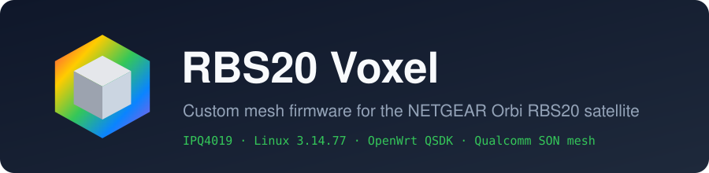
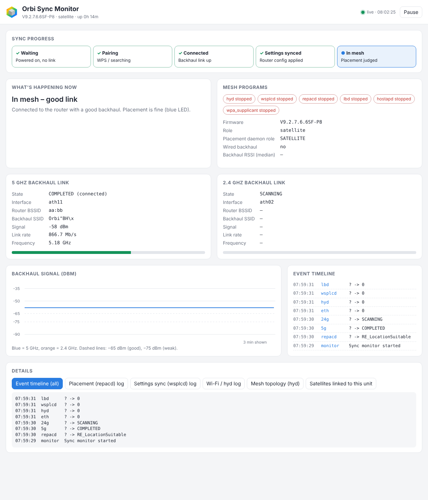
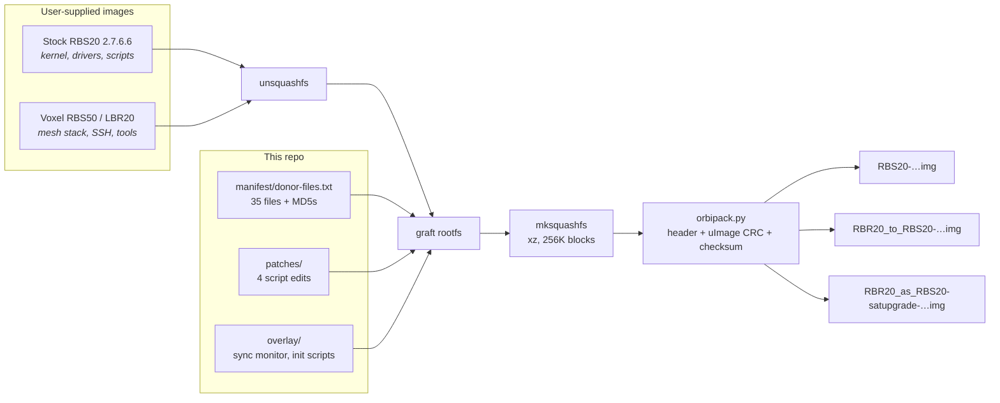
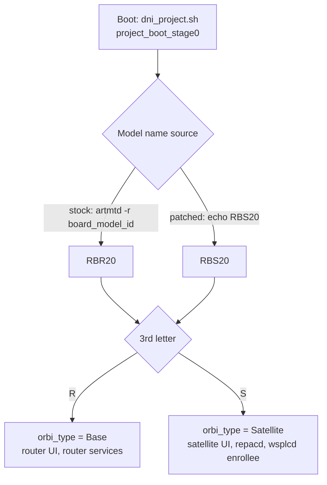

<div align="center">



**Custom firmware that puts Voxel's Orbi mesh stack on the NETGEAR RBS20, a satellite Voxel never supported.**

[](LICENSE)


[Highlights](#highlights) ·
[How it works](#how-it-works) ·
[Quick start](#quick-start) ·
[Sync monitor](#live-sync-monitor) ·
[Results](#results) ·
[Docs](#documentation)

</div>

---

## Overview

Voxel publishes custom firmware for many NETGEAR Orbi models, but not the **RBS20** satellite. My mesh runs a Voxel RBR50v2 router and RBS50v2 satellite, and the RBS20 was the odd one out: it ran a different build of Qualcomm's mesh (SON) software, with no SSH or diagnostic tools.

This project reverse-engineers the Orbi firmware image format, grafts Voxel's mesh stack and tools onto NETGEAR's last RBS20 release, and adds a live web dashboard for watching a satellite join the mesh. The same image also turns an **RBR20 router into an RBS20 satellite**.

> [!NOTE]
> On **2026-10-21** a build from this repo, running on an RBR20 converted to an RBS20, synced into a Voxel RBR50v2 mesh on both backhaul bands: **5 GHz at -52 dBm / 867 Mb/s** and **2.4 GHz at -36 dBm**.

<p align="center">
  <br>
  <sub>The live sync monitor on port 8080, shown in the ARM emulator used to test it before it went on hardware.</sub>
</p>

## Highlights

| | |
|---|---|
| 🔍 **Reverse-engineered image format** | Header, FIT kernel, uImage CRC, padding and checksum decoded from stock images. [`orbipack.py`](tools/orbipack.py) rebuilds stock firmware **byte-for-byte**. |
| 🔗 **Voxel mesh interop** | Swaps in the same `hyd`, `wsplcd`, `hostapd` and SON libraries that Voxel's RBK50 builds run, so the satellite speaks the same mesh stack as the router. |
| 🔁 **Router → satellite conversion** | One boot-script change plus the right header turns an RBR20 into an RBS20, and the image passes NETGEAR's own upgrade checks. |
| 📡 **Live sync monitor** | A dependency-free BusyBox shell dashboard that shows pairing progress, backhaul signal and rate, mesh daemons, topology and logs in real time. |
| 🔐 **SSH that actually works** | I traced "permission denied" to SHA-256 crypt hashes that this uClibc can't verify, and fixed it with MD5 crypt. |
| ✅ **Reproducible, MD5-verified build** | One command builds all three image variants from user-supplied images, checks every donor file's MD5, and is covered by tests. |
| 🛡️ **Security-audited** | A static audit of stock firmware and of my own builds, with known issues disclosed in [SECURITY.md](SECURITY.md). |

## How it works

The build is a **rootfs graft**, not a from-source rebuild. NETGEAR's kernel, device trees and Wi-Fi drivers match the hardware, so they stay. The userland that matters for mesh interop comes from Voxel.



<details>
<summary><b>Firmware image layout</b></summary>

```
0x000000  ┌──────────────────────────────────────────────┐
          │ 128 B text header                            │  device:RBS20 / version / region / hd_id
0x000080  ├──────────────────────────────────────────────┤
          │ FIT image: kernel@1 (gzip) + 9 IPQ40xx DTBs  │
          │ zero padding                                 │
          │ 64 B legacy uImage header                    │  size + CRC32 of the whole rootfs region
0x320080  ├──────────────────────────────────────────────┤
          │ squashfs 4.0, xz, 256 KiB blocks             │
          │ 0xFF padding + 0xDEADC0DE markers            │  4K / 8K / 64K / 128K boundaries
          │ 128 KiB zero block                           │
   end-1  ├──────────────────────────────────────────────┤
          │ 1 B checksum                                 │  0xFF - (sum of all bytes & 0xFF)
          └──────────────────────────────────────────────┘
```
</details>

<details>
<summary><b>How an RBR20 becomes a satellite</b></summary>

RBR20 and RBS20 share a board, a kernel and every script. The role is decided at boot from the model name in factory (ART) data:



Flashing has its own trap. Orbi has **A/B firmware slots**, and a bootloader (NMRP) flash doesn't flip the `boot_part` flag, so the old firmware can keep booting. The web UI upgrader writes the inactive slot and flips the flag, but it checks that the header's `device` matches the running model and `hd_id` matches the board. That's why there are three image variants:

| Unit | Header `device` | Header `hd_id` | Image |
|---|---|---|---|
| Real RBS20 | `RBS20` | `…+128+…` | `RBS20-…` |
| RBR20 on router firmware | `RBR20` | `…+256+…` | `RBR20_to_RBS20-…` |
| RBR20 already a satellite | `RBS20` | `…+256+…` | `RBR20_as_RBS20-satupgrade-…` |
</details>

<details>
<summary><b>What comes from where</b></summary>

| Source | Files | Why |
|---|---|---|
| Stock RBS20 2.7.6.6 | kernel, DTBs, Wi-Fi drivers, scripts, web UI | Matches the hardware |
| Voxel RBS50 / LBR20 | `hyd`, `wsplcd`, `lbd`, `hostapd`, `wpa_supplicant`, `hyctl`, `ucpkgen`, SON libraries | Same mesh stack as the Voxel router |
| Voxel LBR20 | dropbear, haveged, iperf3, nano, ncurses, terminfo | SSH, entropy, speed tests, editing |
| Voxel RBS50 | logo, favicon, spinner | Voxel look on the satellite UI |
| This repo | sync monitor, init scripts, 4 patches | Role fix, SSH fix, monitoring hooks |

| Patch | Change |
|---|---|
| [`01-dni_project-sh`](patches/01-dni_project-sh.patch) | Force model `RBS20` so an RBR20 boots as a satellite |
| [`02-user-manager-sh`](patches/02-user-manager-sh.patch) | MD5 crypt for system passwords; prefer the plaintext admin password |
| [`03-repacd-run-sh`](patches/03-repacd-run-sh.patch) | Publish repacd's state for the monitor |
| [`04-wsplcd`](patches/04-wsplcd.patch) | wsplcd logs at INFO to a file, so config sync can be watched |
</details>

## Quick start

> [!IMPORTANT]
> **No firmware images are included.** They contain NETGEAR and Voxel binaries that can't be redistributed ([NOTICE.md](NOTICE.md)). You supply the images, and the script builds the firmware locally.

**Requirements:** Linux, Python 3.8+, `squashfs-tools`, `patch`, `fakeroot`.

```sh
git clone https://github.com/LachRMIT/rbs20-voxel && cd rbs20-voxel
sudo apt install squashfs-tools patch fakeroot

# put your copies of the three images in inputs/, then:
fakeroot python3 scripts/build.py \
  --stock inputs/RBS20-V2.7.6.6.img \
  --donor inputs/RBR50_to_RBS50-V9.2.5.2.39SF-HW.img \
  --donor inputs/LBR20-V9.2.5.2.57SF-HW.img \
  -o out/
```

The script checks the stock image's MD5 (`b0c6bf4a4fe9afd405b5a639ed466f82`) and every donor file against the manifest, then writes the three variants to `out/`.

**Flashing:** upload the right variant in the unit's web UI under **Firmware Update**, factory-reset it (hold reset for about 10 s) and sync it to the router. A web upgrade back to stock undoes it. The serial console is `ttyMSM0`, 115200 8N1, 3.3 V.

> [!WARNING]
> Custom firmware can brick a unit and voids the warranty. Set a web admin password before flashing (see [SECURITY.md](SECURITY.md)).

**Running the tests** (no firmware needed):

```sh
pip install pytest && python3 -m pytest
```

## Live sync monitor

Watching a satellite sync normally means guessing from LED colours. The monitor runs at `http://<satellite IP>:8080/` (log in as `admin` with the web admin password) and refreshes every 2 s.

- **Sync progress:** Waiting → Pairing → Connected → Settings synced → In mesh, with repacd's state explained in plain English
- **Backhaul links:** router BSSID, signal, PHY rate and frequency for 5 GHz and 2.4 GHz, plus a signal chart
- **Mesh health:** which daemons are running, and a timestamped event timeline
- **Deep dives:** repacd, wsplcd and Wi-Fi logs (secrets masked), the `hyd` 1905 topology, and the satellites linked to this unit

It adds no new binaries. [`syncmon-watch`](overlay/usr/sbin/syncmon-watch) is BusyBox shell that polls `wpa_cli`, `iwconfig`, `wlanconfig`, `logread` and hyd's debug port into a JSON file. A second instance of the stock lighttpd serves an auth-gated CGI and a single-file HTML page ([`index.html`](overlay/usr/share/syncmon/index.html)). Before it went on hardware I tested it in a qemu-user ARM chroot running the image's own BusyBox and lighttpd.

## Results

| Build | Change | Outcome on hardware |
|:---:|---|---|
| P1 | Stock + dropbear, haveged, iperf3, nano | Booted the old router firmware (A/B slot issue) |
| P2–P3 | RBS20 role fix, missing libraries | Same slot issue via NMRP |
| P4 | RBR20 header with the board's real `hd_id`, web UI flash | ✅ **Booted as a satellite** |
| P5 | Voxel mesh stack, SSH using the admin password | SSH refused (crypt issue) |
| P6 | MD5 crypt fix | ✅ **SSH works** |
| P7 | Kernel 3.14.77 compiled from NETGEAR GPL source (-O2, Westwood TCP) | Built; 9 DTBs byte-identical to stock; not yet flashed |
| P8 | P6 + sync monitor + Voxel look | ✅ **Synced into the Voxel RBR50v2 mesh** |

In the P8 sync, the first WPS pairing timed out, repacd retried by itself, and wsplcd then reported *"1905.1 AP Auto Configuration Done"*. Both backhauls came up: 5 GHz on channel 157 and 2.4 GHz. The full log is in [docs/build-history.md](docs/build-history.md).

## Roadmap

- [x] Decode the Orbi image format and rebuild stock byte-for-byte
- [x] Convert an RBR20 to a satellite via the web UI
- [x] Working root SSH
- [x] Voxel mesh stack syncing with a Voxel RBR50v2
- [x] Live sync monitor
- [x] Reproducible build from user-supplied images
- [ ] Bind SSH and the monitor to the LAN only and remove the password fallback ([SECURITY.md](SECURITY.md))
- [ ] Get NETGEAR's SOAP "Config Sync" status to complete (try Voxel's SOAP handler)
- [ ] Enable band steering (`lbd`) on the satellite
- [ ] Flash and test on a real RBS20
- [ ] Hardware-test the from-source P7 kernel

<details>
<summary><b>Known limitations</b></summary>

- The 1905 mesh config sync works, but the RBR50's SOAP-based sync status for this unit stays at "not done", so the router UI keeps showing "Config Sync".
- `lbd` (band steering) stays stopped on the satellite.
- Tested on an RBR20 converted to an RBS20. A real RBS20 takes the same rootfs but hasn't been flashed yet.
- Not a from-source Voxel build: that needs NETGEAR's RBK20 GPL tree rebuilt with Voxel's toolchain and patches, which aren't public.
</details>

## Documentation

| Document | What's in it |
|---|---|
| [Full firmware diff](docs/full-firmware-diff.md) | Image format, what a router→satellite conversion changes, what Voxel changes, A/B slots |
| [Voxel vs stock](docs/voxel-vs-stock.md) | Which Voxel components are reusable on the RBS20 and why |
| [Security audit](docs/security-audit.md) | Static audit of stock 2.7.6.6 and of the P6/P8 builds |
| [Daisy-chain sync](docs/daisy-chain-sync.md) | How a satellite onboards another satellite when the router is out of range |
| [Build history](docs/build-history.md) | Every prototype, P1 to P8, with checksums |
| [Raw data](docs/raw/) | Kernel configs, package lists, file diffs |

## Skills demonstrated

- **Firmware reverse engineering:** binary format analysis (FIT, uImage, squashfs, custom headers and checksums), diffing four firmware images at the file, package, kernel-config and device-tree level
- **Embedded Linux:** OpenWrt/QSDK init system, BusyBox, uClibc, cross-compiling a 3.14 kernel with a vendor toolchain in a chroot, ABI and symbol checks of foreign binaries
- **Networking:** Wi-Fi mesh internals (Qualcomm SON, IEEE 1905.1, WPS, wpa_supplicant/hostapd), backhaul diagnostics
- **Debugging:** root-causing a boot-slot trap and an SSH auth failure from the firmware scripts, and confirming the fixes on hardware
- **Security:** auditing for embedded secrets and exposed services, then responsibly disclosing issues in my own builds
- **Tooling:** Python build and packing tools with tests, a shell and HTML monitoring dashboard, emulator-based testing with qemu-user

## Repository layout

```
scripts/build.py          build images from user-supplied stock + Voxel images
tools/orbipack.py         Orbi RBx20 image packer (header, uImage CRC, padding, checksum)
manifest/donor-files.txt  files taken from Voxel, with MD5s
patches/                  edits to NETGEAR scripts
overlay/                  files added to the rootfs (sync monitor, init scripts)
tests/                    pytest suite (synthetic images, manifest and patch checks)
docs/                     analysis, audit, build history, images
```

## Contributing

Hardware test reports are the most useful contribution, especially from a real RBS20. See [CONTRIBUTING.md](CONTRIBUTING.md).

## Licence

My code and docs are MIT ([LICENSE](LICENSE)). NETGEAR and Voxel material is not included; see [NOTICE.md](NOTICE.md). Not affiliated with NETGEAR or Voxel. Thanks to Voxel for the firmware this builds on.

## Generative AI declaration
I used generative AI (Anthropic's Claude) as an assistant on this project: to help analyse the firmware images, write the build and monitor scripts, and draft the documentation. I set the goals, did all the flashing and testing on my own hardware, and reviewed everything published here.
